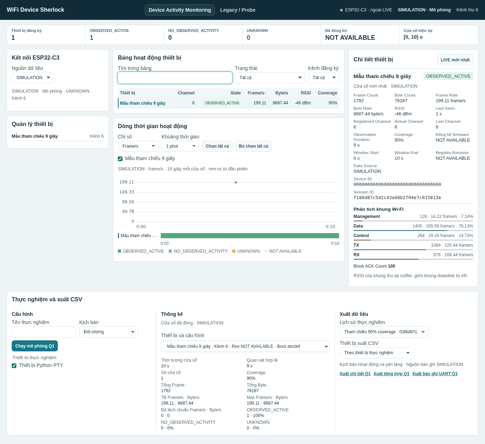
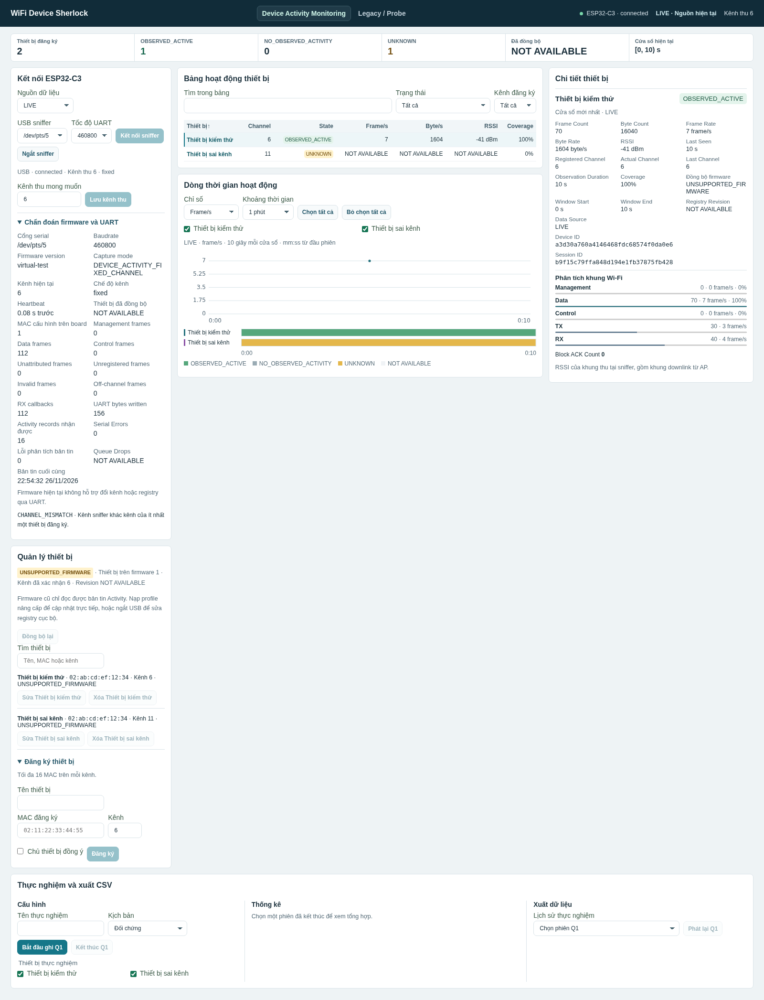
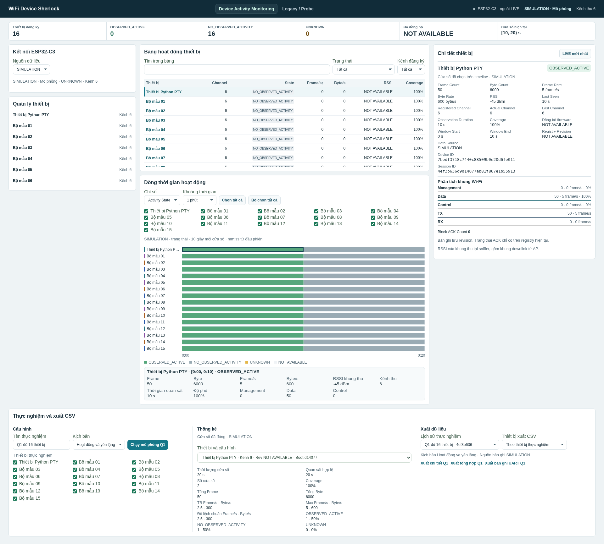

# Q1 Device Activity Monitoring · Báo cáo nghiệm thu redesign

**SOFTWARE VERIFIED.** Q1 đã được kiểm tra với firmware UART giả lập, backend, trình duyệt và CSV.

**HARDWARE NOT VERIFIED.** Không có ESP32-C3 vật lý trong môi trường kiểm thử. Các ảnh và số tham chiếu lấy từ fixture hoặc UART ảo.

## Chức năng trước và sau

| Khu vực | Trước redesign | Sau redesign |
|---|---|---|
| Bố cục | Các phần Q1 xếp dọc. | Header navy hiển thị nguồn, trạng thái ESP32 và kênh thu. Hàng sáu KPI, ba cột khoảng 22/50/28 và hàng thực nghiệm ba phần. |
| Kết nối và registry | USB/UART, cấu hình kênh, CRUD, đồng bộ, chẩn đoán. | Giữ các thao tác và đặt ở cột trái. Chẩn đoán mở rộng bao gồm firmware, capture mode, heartbeat, parser/serial errors và bộ đếm radio. Registry nhìn riêng SYNCED, PENDING, OFFLINE, SYNC_FAILED và UNSUPPORTED_FIRMWARE. SYNCED dựa trên xác nhận backend từ board. |
| Bảng và timeline | Bảng Q1 và biểu đồ tự chọn dạng theo số thiết bị. | Bảng có tìm kiếm, lọc trạng thái/kênh và sắp xếp theo cột. Timeline vẫn có bốn chỉ số, bốn khoảng thời gian và bốn chế độ 0/1/2–4/5–16 thiết bị. Đường số ngắt khi thiếu dữ liệu hoặc đổi boot, kênh hay revision. |
| Chi tiết | Mở chi tiết dưới bảng, tooltip lịch sử. | Cột phải cập nhật khi chọn thiết bị, điểm đường số hoặc ô heatmap. Có nút **LIVE mới nhất** và giữ tooltip. Thêm mốc cửa sổ, nguồn, phiên, revision, kênh của cửa sổ và biểu đồ thanh các bộ đếm/tốc độ khung từ backend. |
| Thực nghiệm | Cấu hình, ghi mốc, lịch sử, Replay, Simulation và ba CSV. | Hàng ngang gồm **Cấu hình**, **Thống kê** và **Xuất dữ liệu**. Thống kê đọc JSON từ cùng logic và bộ lọc như CSV tổng hợp. |
| Phạm vi | Q1 là màn hình chính. Tab Legacy/Probe và backend Q2/Q3 dùng cho các mục đích riêng. | Giữ route và điều hướng cũ. Q1 chạy độc lập khi thiếu CSI và trình duyệt không gọi API Q2/Q3. |

## Thông số đầu ra

- Cửa sổ **10 giây không chồng lấn**. Backend cung cấp Device ID/Name, Activity State, lý do UNKNOWN, Frame Count, Byte Count, Frame/s, Byte/s, RSSI cực đại của khung thu, Last Seen, Registered/Actual/Last Channel, Observation Duration, Coverage, Window Start/End, Data Source, Session ID và registry revision khi có.
- Management/Data/Control có số đếm, frame/s và tỷ lệ trên tổng frame nếu tổng khác 0. TX và RX có số đếm và frame/s riêng. Hai chiều có thể cùng đóng góp cho một khung. Block ACK là bộ đếm trong Control. Bộ đếm toàn kênh nằm trong chẩn đoán.
- CSV chi tiết giữ số thực đầy đủ và bổ sung kênh cửa sổ, tốc độ theo loại/chiều và tỷ lệ Management/Data/Control. UI làm tròn đến hai chữ số thập phân. Chỉ chuyển phân số coverage và tỷ lệ thành phần trăm ở lớp hiển thị.
- CSV tổng hợp và UI thống kê tính theo thời lượng quan sát hợp lệ của từng thiết bị trong mỗi nhóm boot, registry revision, kênh thu và kênh đăng ký tương thích. Mỗi nhóm có số cửa sổ, thời lượng cửa sổ, tổng Frame/Byte, tốc độ trung bình/cực đại, độ lệch chuẩn tổng thể, coverage và số lượng/tỷ lệ của từng trạng thái. Các tỷ lệ trạng thái dùng toàn bộ cửa sổ của nhóm. Cột `activity_ratio` cũ tiếp tục dùng số cửa sổ có kết luận hợp lệ làm mẫu số.
- RSSI của khung thu có thể đến từ AP. Thông số của Q1 mô tả khung Wi‑Fi đã thu và chỉ dùng cho mục tiêu quan sát hoạt động mạng. [Đặc tả đầu ra](OUTPUT_SPECIFICATION.md)

### Ca đối chiếu tham chiếu

| Đại lượng | Khung UART / dữ liệu gốc | Backend và CSV | Dashboard |
|---|---|---|---|
| Frame Count | 128 Management + 1400 Data + 264 Control | 1792 | 1792 |
| Byte Count | 8192 + 60000 + 9995 byte | 78187 | 78187 |
| Observation Duration | 9 giây trọn trong cửa sổ; khoảng cắt biên giữ ngoài cửa sổ | 9 s | 9 s |
| Frame/s | 1792 / 9 | 199.11111111111111 | 199.11 |
| Byte/s | 78187 / 9 | 8687.444444444445 | 8687.44 |
| Coverage | 9 / 10 | 0.9 | 90% |
| TX / RX / Block ACK | 1084 / 976 / 100 | Giữ ba bộ đếm riêng | Thanh TX/RX dùng tổng khung làm thang so sánh riêng cho mỗi chiều. Block ACK hiện riêng. |

## Kiểm thử thực tế

| Kiểm thử | Kết quả | Phạm vi |
|---|---|---|
| pytest | **PASS · 212** | Q1, UART/parser, registry ACK/runtime, sai kênh, hết hạn heartbeat, ngắt kết nối, nguồn tách biệt, thử tham chiếu 9 giây, CSV độ chính xác đầy đủ, chia nhóm theo revision và hồi quy Legacy/Probe, Q2/Q3. |
| TypeScript và Vite | **PASS** | `npm --prefix frontend run build`. |
| Chrome/Playwright | **PASS · 3** | LIVE và replay với UART ảo, CRUD/ACK, lọc/sắp xếp bảng, chi tiết từ timeline, 0/1/2/4/5/8/16 thiết bị, Simulation, ghi mốc, tải ba CSV, thử 1366×768, 1600×900, 1920×1080 và chiều rộng 390 px. |
| Python UART simulator | **PASS · 12/12** | S01–S12 với seed 20261126, gồm các đầu ra backend Q2/Q3 dùng trong hồi quy. |
| ESP32-C3 và RF thật | **NOT VERIFIED** | Cần cắm board chạy firmware Activity để xác nhận timing, ACK và số liệu trong môi trường Wi‑Fi thực. |

Pytest phát một cảnh báo deprecation của AnyIO trong Starlette TestClient.

## Ảnh Dashboard
Ảnh chụp toàn trang với kích thước viewport ghi bên dưới.

**1366×768 · Cửa sổ tham chiếu 9 giây ở nguồn SIMULATION.**



**1600×900 · Chẩn đoán kết nối LIVE qua UART ảo của bài kiểm thử.**



**1920×1080 · Heatmap 16 thiết bị và chi tiết cửa sổ đã chọn.**



## File thay đổi

| File hoặc nhóm file | Mục đích |
|---|---|
| `frontend/src/Dashboard.tsx`, `frontend/src/device-csi/device-csi.css` | Header và style giới hạn trong Q1, bố cục ngang và responsive. |
| `frontend/src/device-csi/DeviceCsiPanel.tsx`, `DeviceActivityTimeline.tsx`, `DeviceCsiExperiments.tsx` | Kết nối/registry, KPI, bảng, chi tiết cửa sổ, timeline và thống kê thực nghiệm. |
| `backend/app/api/device_activity.py`, `backend/app/api/device_csi_experiments.py` | Trả phân tích khung trong snapshot/lịch sử, bổ sung trường CSV và trả tổng hợp chung cho Dashboard. |
| `research/device_activity.py`, `research/collector.py` | Tính chỉ số từ kết quả đã quy gán theo thiết bị và chuyển thêm bộ đếm chẩn đoán thực có trong Status UART. |
| `tests/dashboard_browser.mjs`, `tests/test_registered_device_monitor.py`, `tests/test_runtime_registry.py` | Ca tham chiếu từ JSONL UART qua API/CSV, hồi quy revision/registry và trình duyệt/chụp ảnh. |
| `docs/OUTPUT_SPECIFICATION.md`, báo cáo này, `docs/assets/q1-redesign/*.png` | Đặc tả các trường bổ sung, nghiệm thu và ảnh. |

## Cách chạy và kiểm nghiệm

Tại thư mục gốc repository, chạy các lệnh sau rồi mở địa chỉ in trên Terminal. Cổng mặc định là 8000 và Dashboard ở hash `#device-activity`.

```bash
npm --prefix frontend run build
bash run.sh
```

- **Kiểm nhanh với SIMULATION** · Chọn nguồn, nhập tên, chạy mô phỏng Q1, chọn điểm trên timeline rồi xem chi tiết và tải CSV của phiên.
- **Kiểm trên ESP32 thật** · Chọn LIVE, kết nối cổng ESP32 đúng baud, xác nhận heartbeat và kênh, đăng ký thiết bị đã đồng ý cùng kênh và kiểm tra SYNCED. Ghi phiên, đổi lưu lượng rồi so Frame/Byte và thời gian thu của cùng Device ID, cửa sổ và revision giữa raw UART, bảng/timeline và CSV. Thử sai kênh và rút USB để đối chiếu UNKNOWN. [Checklist phần cứng đầy đủ](implementation/Q1_DEVICE_ACTIVITY_DASHBOARD.md#kiểm-nghiệm-với-esp32-c3-và-nhiều-thiết-bị)

Lệnh kiểm phần mềm và chụp ảnh.

```bash
.venv/bin/python -m pytest -q
npm --prefix frontend run build
Q1_SCREENSHOT_DIR=docs/assets/q1-redesign node --test tests/dashboard_browser.mjs
```

Nếu Playwright nằm ngoài node_modules của dự án, đặt `DASHBOARD_PLAYWRIGHT_MODULE` trỏ đến `playwright/index.mjs`. Có thể chỉ định Chrome bằng `DASHBOARD_TEST_CHROME`.

## Giới hạn

- Trạng thái ACK lịch sử là NOT AVAILABLE vì bản ghi có revision nhưng không lưu snapshot trạng thái đồng bộ cho từng cửa sổ. Device Activity v2 cũ thiếu tính năng cấu hình runtime được đánh dấu UNSUPPORTED_FIRMWARE.
- Kết quả thống kê thực nghiệm xuất sau khi kết thúc và hiển thị theo nhóm cấu hình tương thích. Bản ghi mô phỏng cũ có thể thiếu Raw Capture CSV. Tỷ lệ loại khung và RSSI cần khung đo được; TX/RX có thể thiếu ở nguồn cũ.
- Cửa sổ đang hiển thị LIVE có thể thành UNKNOWN khi heartbeat hết hạn. Timeline và CSV của phiên đã ghi giữ số đo tại thời điểm cửa sổ đóng.
