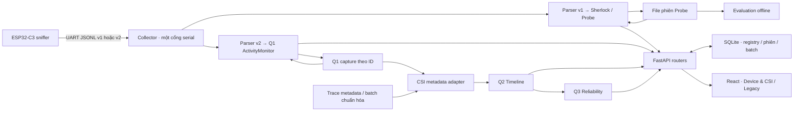

# Cấu trúc repository

| Đường dẫn | Trách nhiệm |
|---|---|
| `firmware/sniffer/`, `firmware/common/` | Một dự án ESP-IDF cho Probe hopping, Probe fixed và Device Activity fixed. Giữ đường dẫn để dùng chung CMake, CI, flash và profile cục bộ. |
| `backend/app/main.py`, `backend/app/api/` | FastAPI lifespan và kết nối ứng dụng; router theo Probe, Q1, Q2 và Q3. Route xử lý lỗi validation dùng chung để tránh đưa dữ liệu đầu vào vào phản hồi. |
| `backend/app/{protocol,device_activity_protocol,storage}.py` | Biên UART JSONL v1/v2 và SQLite. Giữ parser CLI và các import đang dùng từ cả server lẫn nghiên cứu. |
| `frontend/src/{device-csi,legacy-probe}/` | Màn hình mặc định Device & CSI và tab Legacy / Probe. `Dashboard.tsx` chọn tab. `api.ts` và CSS dùng chung ở `src/`. |
| `research/` | Collector và record/replay dùng chung với API, thuật toán Q1/Q2/Q3, baseline Probe, CLI và evaluation. Giữ các tên module công khai vì lệnh thực nghiệm và runtime dùng cùng code. |
| `configs/`, `scripts/`, `tests/` | Preset có thể tái lập; setup/dev/build/flash/serve/package; kiểm thử hợp đồng, thuật toán, tích hợp và UI. Pytest chạy từ root để dùng chung fixture. |
| `docs/{architecture,implementation,experiments,legacy}/` | Kiến trúc và giao thức, hướng dẫn từng module, quy trình/báo cáo thí nghiệm, tài liệu baseline và lịch sử. Schema máy đọc vẫn ở `docs/`. |

## Sơ đồ phụ thuộc và luồng dữ liệu

Trong Python, `main` lắp các router và tạo một `ProbeService`. Router gọi các hàm `research` để xử lý hoặc đọc state từ service. Collector dùng parser/storage trong backend, còn Q2 dùng mô hình metadata/capture và Q3 dùng Q2. Các CLI đọc lại dữ liệu qua cùng parser và loader. Không cần tạo package trung gian cho từng lớp khi ranh giới đã được giữ bằng module.

[Audit và kiểm kê](REPOSITORY_CLEANUP_AUDIT.md) · [Hướng dẫn chạy](UBUNTU_RUNBOOK.md) · [Thay đổi đường dẫn](MIGRATION_NOTES.md)
