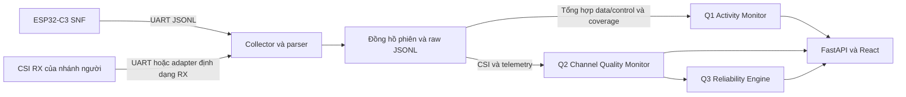

# Device CSI Reliability MVP

**Hướng nghiên cứu** · Passive WiFi Device Activity Monitoring and Channel Quality Assessment for Reliable CSI-Based Human Sensing

MVP dùng ESP32-C3 SNF nghe thụ động trên kênh cố định của router 2,4 GHz cho Q1. Q2/Q3 nhận dữ liệu của một luồng RX trên kênh sensing HT20 từ bộ TX/RX của nhánh người. Bắt đầu với một RX rồi ghép RX thứ hai khi có mẫu log và đã xác minh đồng bộ. Mỗi cổng có một chủ sở hữu serial, dùng chung đường collector → parser → SQLite/record/replay → FastAPI → React. Phiên đo hoạt động thường dùng hai kênh riêng. Trong lượt thử tải đồng kênh, cấu hình thiết bị tạo tải trên kênh sensing và ghi kênh thực tế của từng nguồn. [Đề xuất nhánh thiết bị, mục 4 và 6](DE_XUAT_NHANH_THIET_BI.md)

Q1/Q2 dùng phương án thu của đề xuất. Q3 trong phạm vi nghiên cứu là **CSI Reliability Engine**. Chức năng **chọn người nhận cảnh báo** mà đề xuất gọi là Q3 thuộc tích hợp nhánh người, dự kiến sau khi đã xác minh dữ liệu và chính sách cảnh báo. [Đề xuất nhánh thiết bị, mục 2 và 5](DE_XUAT_NHANH_THIET_BI.md)

## Q1 · Registered Device Activity Monitor

- Registry SQLite lưu `device_id` UUID, `label`, `enabled` và bindings `{source_mac, channel}` khai báo với sự đồng ý của chủ thiết bị. Dùng MAC thực tế mà thiết bị báo khi kết nối mạng demo WPA2/WPA3. Mỗi MAC/kênh chỉ thuộc một thiết bị đang bật. Snapshot registry được khóa theo phiên để replay. Chỉ đưa `device_id` và nhãn lên dashboard mặc định. Ghi binding mới nếu MAC thay đổi. Thiết bị chạy nền như TV/loa nằm ngoài registry hoạt động người dùng.
- SNF chỉ đọc header hợp lệ, tổng hợp 1 s theo MAC ứng viên và kênh. Khớp sender/receiver với registry ở host. Một khung chỉ tính một lần cho mỗi thiết bị. Xác minh thực địa khả năng thu Block Ack và gán địa chỉ phát của điện thoại. ESP-IDF mô tả callback khung MIMO chỉ cung cấp độ dài. Thống kê phần không gán được MAC vào telemetry tổng, giữ riêng với số theo thiết bị. Probe/Sherlock tiếp tục là baseline độc lập. [ESP-IDF 5.5.4, Wi-Fi Sniffer Mode](https://docs.espressif.com/projects/esp-idf/en/v5.5.4/esp32c3/api-guides/wifi.html#wi-fi-sniffer-mode)
- Gộp vào khe 10 s không chồng lấn, gồm `frame_count`, `byte_count`, `rssi_max_dbm`, `eligible_coverage_us` và `device_active: true|false|null`. `true` khi số khung quan sát đạt ngưỡng phát triển đã chốt. `false` khi đủ độ phủ và số khung dưới ngưỡng. `null` khi thiếu độ phủ, telemetry hoặc không xác định được cửa sổ. Khởi điểm thử là ≥ 80% phủ và ≥ 1 khung, sau đó chọn ngưỡng từ các lượt có thao tác và khóa màn hình để đo ảnh hưởng của lưu lượng nền. Nhãn hoạt động người dùng lấy từ ghi chép thao tác. `device_active` là kết quả từ hoạt động mạng quan sát được.

## Q2 · CSI Channel Quality Monitor

- Bước đầu xác minh log thật của RX, gồm layout, kiểu board/IDF, bandwidth, trường `STAT` và thời gian. Bắt đầu với HT20 và một layout LLTF của TX tham chiếu. Kiểm tra độ dài/mặt nạ từ mẫu thật theo board và config. Với RX ESP32-C3, `first_word_invalid` đánh dấu bốn byte đầu. [Hướng dẫn CSI ESP-IDF 5.5.4](https://docs.espressif.com/projects/esp-idf/en/v5.5.4/esp32c3/api-guides/wifi.html#wi-fi-channel-state-information)
- Báo nhịp 1 s theo RX/kênh gồm `foreign_csi_rate_hz`, `reference_csi_rate_hz`, `noise_floor_dbm` và `channel_busy: true|false|null`. Với counter tích lũy, lấy delta của hai `STAT` hợp lệ trong cùng epoch chia cho thời lượng thực tế. Với `STAT` đếm từng khoảng, dùng count của đúng khoảng đã xác minh. Đặc tả nhóm mô tả `n_rx` là số dòng CSI đã xuất trong giây vừa qua, vì vậy chỉ ánh xạ thành tốc độ CSI đã xuất và giữ riêng với số callback TX tham chiếu. Cần xác nhận `n_filtered` đếm callback CSI khác TX và là dạng tích lũy hay theo khoảng. So với lượt yên tĩnh và lượt có tải đồng kênh trước khi đặt ngưỡng `channel_busy`. Các khung RX không quan sát được hoặc không sinh CSI nằm ngoài chỉ số này. Gợi ý đổi kênh chỉ để người vận hành cân nhắc, vì đổi kênh cần đo lại baseline CSI. [Đặc tả nhóm, mục 3.4](../../Dac_ta_dinh_dang_du_lieu%20%282%29.md)
- Tính riêng theo `link_id` ánh xạ cố định từ `(board_id, source_mac, channel, bandwidth_mhz, layout_id)`. Dùng cửa sổ 5 s, bước 1 s, mốc từ đầu phiên. Khóa các mốc biên theo số nguyên µs. Đo số CSI hợp lệ, tỷ lệ hợp lệ trong số CSI nhận, sample rate, P95 khoảng cách giữa mẫu liên tiếp, RSSI median, noise floor median nếu có, tỷ lệ mẫu có I/Q chạm biên, coverage và các cờ reset/drop/late/sync. Time span không đều được phản ánh thêm bởi `max_gap_us`, gồm cả khoảng từ biên cửa sổ đến mẫu gần nhất. Dùng `null` khi không có mẫu.
- `sample_rate_hz` bằng số mẫu hợp lệ chia cho thời lượng cửa sổ. `coverage_fraction` bằng thời lượng nghe hợp lệ trên đúng kênh chia cho thời lượng cửa sổ, suy ra từ heartbeat và control. `valid_fraction` bằng `valid_count / received_count`, dùng `null` khi mẫu số bằng 0. `clipped_fraction` dùng các mẫu hợp lệ và chỉ kiểm tra byte I/Q còn lại sau khi áp mặt nạ layout. P95 cần ít nhất hai mẫu hợp lệ.
- Telemetry phân biệt queue drop của firmware, lỗi UART được báo, số dòng parse lỗi tại host và gap `seq` luồng UART. Báo queue drop cùng khoảng đo từ heartbeat hợp lệ. Khi thiếu lịch truyền tham chiếu, sample rate và gap mô tả mẫu thu được. Đo chiều dài dòng và tải từng cổng. Với 460800 8N1, trần lý thuyết khoảng 46 kB/s và mục tiêu thử ≤ 30 kB/s, tính cả status.

## Q3 · CSI Reliability Engine

- Chạy tập quy tắc có phiên bản, độc lập với nhịp polling. `unknown` khi nguồn chưa hỗ trợ CSI, thiếu đồng bộ/telemetry hoặc chưa có cửa sổ đầy đủ. `reject` khi đã xác định vi phạm điều kiện cứng, gồm gap nguồn trong cửa sổ, profile thay đổi hoặc không đạt ngưỡng mẫu/độ phủ. `degraded` khi đạt điều kiện cứng nhưng có cờ mềm (drop, clipping hoặc biến động cadence vượt ngưỡng cấu hình). `usable` khi đạt tất cả. Thứ tự quyết định `reject` khi đã xác định vi phạm cứng, rồi `unknown`, `degraded`, `usable`. Với cửa sổ đầy đủ và nguồn khỏe, zero CSI count là bằng chứng thiếu mẫu. Phiên v1 thiếu khả năng CSI trả `unknown` kèm `no_csi_capability`.
- Giá trị khởi tạo để kiểm thử cơ chế gồm ≥ 20 mẫu hợp lệ, coverage ≥ 0,90, `max_gap_us ≤ 1_000_000`, `sync_uncertainty_us ≤ 100_000`. Schema cấu hình có cả ngưỡng mềm và `policy_version`. Chốt các giá trị đo lường bằng tập development sau khi kiểm tra board và link. Sensing baseline tiêu thụ các cửa sổ `usable` cùng số liệu Q2 và lý do Q3. Q1 đứng cạnh trên timeline để phân tích thực nghiệm.
- Đo coverage, tỷ lệ abstain, phân bố lý do và thay đổi lỗi/F1 của cùng một sensing baseline với và không dùng gate. Chia theo buổi/bố trí thành development và test, đóng băng policy trước test. Báo cả lỗi trên phần được gate giữ lẫn tỷ lệ phần bị loại. Dùng mốc nhãn người độc lập và loại cửa sổ cắt ngang mốc đổi nhãn khỏi phép tính F1. Các phiên đối chứng gồm phòng trống/có người đứng yên/đi bộ, nguồn im lặng, đường thu có gián đoạn hoặc queue drop. Tách tác động của gate khỏi thay đổi baseline và giữ fixture synthetic riêng.

## Tích hợp với nhánh người

- Nhánh người nhận `device_active`, `channel_busy` và trạng thái reliability kèm lý do. Chỉ thử hiệu quả của Q1 đối với cảnh báo bất động nhẹ và giới hạn thời gian hoãn, với 15–30 phút là tham số đề xuất cần thẩm định. Cảnh báo té ngã/hô hấp và chế độ giám sát một người do nhánh người quyết định. Reliability là dữ liệu chẩn đoán và không dùng để trì hoãn, hủy hoặc chặn cảnh báo khẩn cấp.
- Luồng chọn người nhận, Telegram, ACK, chuyển tiếp và thử nghiệm thiết bị lạ là hạng mục tích hợp sau MVP. Nếu triển khai, tách contact khỏi registry thu và dùng tín hiệu từ thiết bị như bằng chứng phụ cùng timeout chuyển tiếp. Đánh giá trên cùng lượt thu với và không có dữ liệu nhánh thiết bị, báo số báo sai mỗi giờ, số sự kiện phát hiện được, độ trễ và thời gian đến ACK. [Đề xuất nhánh thiết bị, mục 3, 5 và 8](DE_XUAT_NHANH_THIET_BI.md)

## Contract giao tiếp MVP

### UART và file phiên

Các kiểu v1 giữ nguyên. JSONL v2 dùng UTF‑8, LF và giới hạn 16000 byte/dòng. UART SNF giữ 460800 8N1. Cổng RX dùng baud theo profile đã xác nhận. V2 dispatch bằng `(v, type)` và khai báo `node:sniffer|csi_rx`, `boot_id`, `ts_us` (integer µs từ boot), `seq` (uint32, thứ tự phát từng nguồn, wrap modulo 2³²). `board_id` ổn định khai báo theo nguồn trong cấu hình phiên và wrapper. Nếu nhận định dạng `CSI,`/`STAT,` từ RX, một adapter theo `format_version` chuyển sang mẫu nội bộ sau khi đối chiếu với log thật. Trường nguồn thiếu giữ `null` và gắn lý do. Số thứ tự ingest của adapter dùng để replay, còn gap UART dùng số thứ tự từ board khi định dạng có trường này.

| Packet v2 | Trường riêng |
|---|---|
| `probe`, `channel` | Payload tương ứng v1. Mỗi bản ghi v2 chứa kênh thực tế của sự kiện. |
| `activity_sample` (`sniffer`) | `source_mac`, `channel`, `duration_us:1000000`, `n_frames:uint`, `n_bytes:uint`, `rssi_max_dbm:int|null`. `ts_us` là đầu khoảng tổng hợp của board. `source_mac` là địa chỉ ứng viên bắt gặp ở vai trò gửi hoặc nhận. |
| `status` (`sniffer`) | Payload v1, thêm `activity_enabled:bool`, `activity_dropped:uint32`, `unattributable_frames:uint32`. Counter tích lũy theo boot. `ts_us` lấy lúc tạo heartbeat. |
| `status` (`csi_rx`) | `capture_active:bool`, `channel`, `bandwidth_mhz`, `csi_enabled:bool`, `reference_csi_seen`, `foreign_csi_seen`, `csi_dropped`, `serial_errors` (counter tích lũy theo boot, `null` cho trường adapter thiếu), `noise_floor_dbm:int|null`, `layout_id:string|null`. `foreign_csi_seen` ánh xạ từ `n_filtered` khi ngữ nghĩa đã được xác nhận. |
| `csi` | `source_mac`, `channel`, `bandwidth_mhz:20`, `rssi` (dBm), `noise_floor_dbm:int|null`, `layout_id:string`, `first_word_invalid:bool`, `csi_len_bytes:int`, `iq_b64:string`. Decode base64 ra signed int8 theo cặp với thứ tự `[imag, real]`. Byte count phải khớp và chẵn. Layout quyết định độ dài và mặt nạ. Layout ngoài profile được đếm lỗi định dạng trong Q2. |

Giữ `raw.jsonl` và wrapper hiện có. Với phiên mới, thêm `board_id`, `capture_epoch` (số nguyên riêng từng board từ 0), `rx_elapsed_us` (thời gian nhận), `event_us:int|null`, `sync_uncertainty_us:int|null` và `time_quality:aligned|arrival_only|legacy`. `host_elapsed_s = rx_elapsed_us / 1e6`. `host_time` vẫn là UTC ISO 8601. `packet` và `control` loại trừ nhau. Control và nhãn do host tạo dùng monotonic trực tiếp. Metadata chốt `capture_schema_version`, `session_epoch_utc`, board/profile, trạng thái hỗ trợ CSI, registry theo `device_id`, `policy_version`, cấu hình, `synthetic` và các mốc đồng bộ. SQLite lưu metadata và sự kiện, còn mẫu I/Q nằm trong file phiên.

Trước khi ghi phiên v2, thay MAC khớp registry bằng `device_id`, MAC nguồn CSI tham chiếu bằng `link_id`, và bỏ thống kê từng MAC chưa đăng ký. Chỉ lưu tổng số không gán được địa chỉ. Snapshot registry dùng cho replay giữ ID, nhãn và kênh đã áp dụng, còn bindings MAC nằm trong registry cục bộ cho khâu ingest. Schema file v2 mô tả bản ghi đã chuẩn hóa này. Phiên Probe v1 giữ schema lưu trữ cũ để replay.

Adapter RX lưu `telemetry_interval` khi nguồn báo số liệu theo kỳ, gồm `start_us`, `end_us` và count đã phân loại như `csi_emitted`, `foreign_csi`, `csi_dropped`. Giữ các counter tích lũy tương ứng ở `null` nếu nguồn chỉ cung cấp số theo kỳ. Các trường đầu ra lấy từ thời lượng đo thực tế và giữ `null` khi chưa xác minh được nghĩa hoặc biên khoảng.

### Đồng bộ thời gian và replay

1. Lấy `monotonic_ns()` khi đọc xong chunk từ UART. Mọi dòng hoàn thành trong chunk cùng mốc nhận. Ghi mốc UTC để tra cứu. Mốc monotonic lúc start phiên là gốc `0`. Các nhãn người/thiết bị dùng cùng mốc host. Với nhãn v2, thêm `t_us` nguyên vào `truth.jsonl`, giữ `t_s = t_us / 1e6` và các trường nhãn v1. Không nối `ts_us` trực tiếp qua hai boot. Heartbeat snapshot legacy ghi ở đầu phiên không được dùng làm anchor mới.
2. Tách epoch theo từng `board_id` tại boot mới, reconnect, gián đoạn heartbeat hoặc timestamp trên các heartbeat liên tiếp đi lùi. Dòng dữ liệu đến muộn không kích hoạt reset. Giữ timestamp capture nguyên bản. Mỗi epoch bắt đầu với `arrival_only`. Đo biên trễ UART+buffer+host `L_min`, `L_max` riêng mỗi cổng. Với mỗi heartbeat `(b_i, r_i)` của epoch, mô hình `event_us = a × ts_us + b` phải thỏa `r_i−L_max ≤ a × b_i + b ≤ r_i−L_min`, cùng khoảng drift `a` đã kiểm tra trên board. Dùng tối thiểu ba heartbeat đã nhận để tìm miền khả thi trong cửa sổ anchor gần nhất. Lấy trung điểm khoảng dự báo và nửa độ rộng làm bất định, làm tròn bảo toàn biên. Nếu chưa hiệu chuẩn hoặc miền rỗng, ghi `event_us=null` và `arrival_only`. Hai RX dùng chung gốc host và giữ bất định riêng khi ghép mẫu.
3. Ghi kết quả mapping tại lúc ingest và giữ kết quả đó trong raw. Tiến đồng hồ theo monotonic của nguồn và xếp mẫu vào cửa sổ theo `event_us`, với tie-break theo thứ tự file. Cửa sổ `[start_us,end_us)` công bố sau `end_us + allowed_lateness_us`. Giá trị thử là 2.000.000 µs để chờ cả heartbeat kế tiếp. Với CSI, giữ raw và gắn `boundary_uncertain` nếu khoảng bất định chạm biên cửa sổ. Với tổng hợp SNF, chỉ tính count khi toàn bộ khoảng đo 1 s cùng biên bất định nằm trong một khe 10 s. Trừ phần không phân bổ chắc chắn khỏi độ phủ dùng để kết luận `false`. Mẫu tới sau khi đóng cửa sổ hoặc của epoch đã đóng vẫn lưu raw và đếm late. Cửa sổ bắc qua gián đoạn không ghép dữ liệu giữa epoch. Counter reset/wrap xử lý trong epoch, với baseline mới nếu chênh lệch không xác định được.
4. Giữ replay v1 và API `/api/probe/*`. Replay v2 đọc theo thứ tự file, tiến đồng hồ ảo bằng `rx_elapsed_us` và dùng lại `event_us`, bất định, transition và cấu hình đã lưu. Trong khoảng im lặng, collector live và replay dùng cùng quy tắc xử lý deadline. Khi kết thúc phiên, cả hai chỉ chốt cửa sổ đầy đủ đến mốc `session_stopped`, với cờ thiếu telemetry nếu cần. Hệ số speed chỉ thay thời gian chờ. Link/window keys và nội dung Q1–Q3 phải bằng live cho cùng input, ngoại trừ metadata hiển thị nguồn. Nếu file cũ dùng `CSI,`/CSV theo đặc tả nhóm, chỉ bổ sung adapter offline khi có một mẫu thật và quy ước trục thời gian được xác nhận.

### Kết quả và API mới

`GET /api/device-csi/state` trả `version:"device-csi-v1"`, `source_id`, `source:LIVE|REPLAY|DEMO|null`, `session_id:string|null`, `as_of_us`, `connection`, `activity`, `channel`, `quality`, `reliability`. Khóa cửa sổ gồm `{session_id, window_start_us, window_end_us}` và `device_id` (Q1), `{board_id, channel}` (kênh 1 s) hoặc `link_id` (Q2/Q3). Q2 và Q3 ghép theo khóa link/cửa sổ. Khi đặt Q1, telemetry 1 s và CSI trên cùng timeline, đối chiếu theo khoảng thời gian vì độ dài cửa sổ khác nhau. Phiên chưa bắt đầu dùng `source_id` làm định danh tạm và `session_id=null`.

| Danh sách | Payload thêm vào khóa |
|---|---|
| `activity` | `device_active:bool|null`, `frame_count:int|null`, `byte_count:int|null`, `rssi_max_dbm:int|null`, `eligible_coverage_us:int|null`, `reason_codes:string[]`. |
| `channel` | `channel_busy:bool|null`, `foreign_csi_rate_hz:number|null`, `reference_csi_rate_hz:number|null`, `noise_floor_dbm:int|null`, `reason_codes:string[]`. |
| `quality` | `board_id`, `channel`, `layout_id`, `valid_count`, `received_count`, `valid_fraction`, `sample_rate_hz`, `p95_gap_us`, `max_gap_us`, `rssi_median_dbm`, `noise_median_dbm`, `clipped_fraction`, `coverage_fraction`, `sync_uncertainty_us`, `telemetry` (counter delta và biên khoảng đo), `reason_codes`. Giá trị chưa đo dùng `null`. |
| `reliability` | `state:usable|degraded|reject|unknown`, `policy_version`, `reason_codes` như `no_csi_capability`, `sync_unready`, `heartbeat_gap`, `profile_changed`, `low_sample_count`, `queue_drop`. |

`GET /api/device-csi/registry` trả `{devices: [...]}` theo schema registry của Q1. `PUT /api/device-csi/registry` nhận và trả cùng schema, thay nguyên danh sách đã validate trong một transaction khi idle. Registry của nguồn đã mở giữ snapshot riêng. Replay v1 thiếu dữ liệu data/control nên Q1 không có kết quả hoạt động. Start/stop, USB và replay dùng vòng đời collector hiện có. Thêm cấu hình nguồn vào metadata khi bắt đầu phiên. Dùng whitelist đường tải hiện có để xuất `activity-windows`, `channel-windows`, `quality-windows`, `reliability-windows` dạng JSONL cùng contract. Thêm panel React dùng HTTP polling và kiểm tra `source_id`. UI giữ số 0 và `null` theo đúng ngữ nghĩa.

## Danh sách file triển khai

| Thứ tự | Sửa | Thêm | Điều kiện hoàn thành |
|---|---|---|---|
| 1 · UART, ingest và replay | `backend/app/protocol.py`, `research/collector.py`, `docs/PROTOCOL.md` | `docs/device-csi-wire.schema.json`, `research/capture_time.py`, `research/capture_records.py` | V1 replay giữ kết quả. Fixture SNF/RX qua parser, record và replay với một worker mỗi cổng. Đo jitter và tải riêng từng UART. |
| 2 · Q1 | `firmware/sniffer/main/{main.c,Kconfig.projbuild,CMakeLists.txt}`, `backend/app/storage.py` | `firmware/sniffer/main/activity_capture.{c,h}`, `research/device_activity.py`, `configs/device-csi.json` | Đo thấy khung data/control và xác minh Block Ack/MAC trên board, so thao tác với khóa màn hình, thử kết nối lại và khởi động lại Android/iOS. Kiểm tra schema lưu trữ không có MAC thô của thiết bị. |
| 3 · Q2/Q3 | `research/collector.py` để nối đầu vào và xuất cửa sổ | `research/csi_rx_adapter.py`, `research/csi_quality.py`, `research/csi_reliability.py` | Xác nhận log RX và nghĩa mỗi counter trước khi tích hợp. Kiểm tra CSI lỗi, tải đồng kênh, counter wrap/reset, biên nhãn, mẫu trễ, mất heartbeat, thiếu CSI và live/replay ở nhiều tốc độ. |
| 4 · API/UI | `backend/app/{main,probe_api}.py` (mount router, whitelist export), `frontend/src/Dashboard.tsx`, `.env.example`, `README.md` | `backend/app/device_csi_api.py`, `frontend/src/DeviceCsiPanel.tsx`, `tests/test_device_csi.py`, fixture v2 dưới `tests/fixtures/` | API regression v1, test serial ảo + phiên v2, UI thể hiện dữ liệu thiếu và các lý do gate. Xác nhận lại build/test CI. |

Các tệp trong bảng là phạm vi công việc sau audit. Lệnh dựng và kiểm thử baseline nằm trong [kiểm kê tái sử dụng](REUSE_AUDIT.md).
